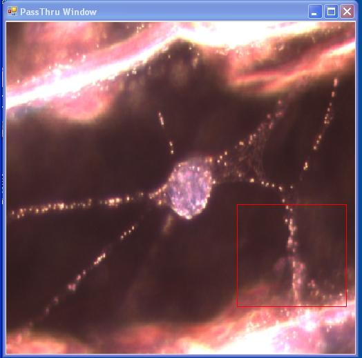
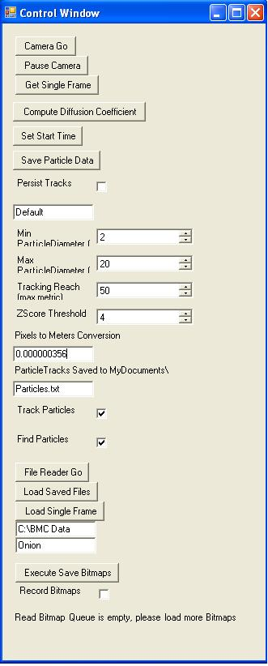
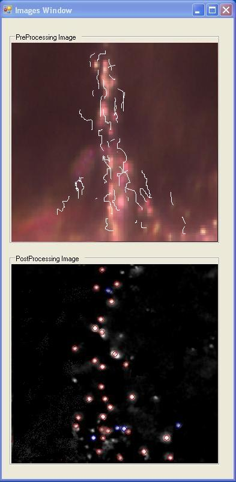

**Contents**

  - [1 Introduction to the Software](#introduction-to-the-software)
      - [1.1 The Brownian Motion Application in C\#](#the-brownian-motion-application-in-c)
          - [1.1.1 GoodStuff](#goodstuff)
          - [1.1.2 CameraDriver](#cameradriver)
          - [1.1.3 BrownianMotion](#brownianmotion)
          - [1.1.4 BrownianApplication](#brownianapplication)
      - [1.2 Using the Brownian Motion Application](#using-the-brownian-motion-application)
      - [1.3 Saved Data Formatting](#saved-data-formatting)
      - [1.4 Saving and Reading Video Streams](#saving-and-reading-video-streams)
      - [1.5 How it Works - Blob Finding](#how-it-works---blob-finding)
      - [1.6 How it Works - Particle Tracking](#how-it-works---particle-tracking)
      - [1.7 How it Works - Statistics](#how-it-works---statistics)
  - [2 Improving the Software](#improving-the-software)
      - [2.1 Removing the Background Image](#removing-the-background-image)
          - [2.1.1 Real-time averaging](#real-time-averaging)
              - [2.1.1.1 Theory](#theory)
              - [2.1.1.2 The Software](#the-software)
      - [2.2 Centroiding](#centroiding)

# Introduction to the Software

Note: There are two (2) programs to be concerned with in this experiment: 

**Brownian Application Software** and **Brownian** **Simulation.**

Brownian Application (for particle tracking; this can usually be found on the desktop):

C:\\BMC\_Code\\Brownian Motion Software\\BMC\\Brownian Motion Software\\BMC Code Student Version\\BrownianApplication\\bin\\Debug\\BrownianApplication.exe

Brownian Simulation (great for getting a hang of the software):

C:\\BMC\_Code\\Brownian Motion Simulation Software\\BrownianApplication.exe - Simulations

The following instructions should be done if either no images are seen (assuming the image seen through the microscope is okay and you have the microscope deflector at less 50% to the camera and the other to the eye pieces of the microscope) or an error pops up after clicking on the “Camera Go” button in the “Control Window” of the Brownian Application Program.

1\. Start the Brownian Application Program (Icon on the desktop)

2\. Click on “Camera Go” button

3\. If you do not see any Images or you get an error, then call 111 Staff

12\. ONLY Close the “Control Window”. It will close all the other windows.

The Program:

The particle tracking software in this experiment is called Brownian Application.This software performs all necessary tasks in interfacing with the camera, capturing data, finding particles in the video stream and connecting them to form particle tracks. In addition it will perform some basic statistics on the data, write particle trajectory information to file and deal with writing and reading in previously captured data.

When run, there are three basic windows. 

  - The PassThru Window depicts the output from the CCD camera onto the computer screen; in essence, it sees exactly what the camera sees. It contains a red box that you can move around by  clicking on the window to reposition it. Additionally, the size of the box can be modified by holding down shift or Ctrl while clicking on the screen. Only data contained within the red box will be processed.
  - The Control Window contains various user controls which allow the user to control the camera and input the proper parameters for image analysis and particle tracking.
  - The Images Window contains two graphical displays. The one on top is the raw image data contained within the red box on the PassThru window. When tracking particles, the tracks will also appear overlayed on this window. The bottom window shows the same image, except it will have been run through various filters to improve the software's ability to recognize a particle. This is referred to as post image processing. Also, any found particles will be circled. Blue for untracked particles, Red for tracked ones.

<table style="width:100%;">
<colgroup>
<col style="width: 14%" />
<col style="width: 14%" />
<col style="width: 14%" />
<col style="width: 14%" />
<col style="width: 14%" />
<col style="width: 14%" />
<col style="width: 14%" />
</colgroup>
<tbody>
<tr class="odd">
<td>

This is the PassThu Window. It shows on the screen exactly what the camera picks up from the microscope.
</td>
<td> </td>
<td> </td>
<td>

This the Control Window. It contains various user controls to observe the camera on the computer.
</td>
<td> </td>
<td> </td>
<td>

This is the Images Window. It displays the raw and processed image in the top and bottom boxes respectively.
</td>
</tr>
</tbody>
</table>

### The Brownian Motion Application in C\#

The particle tracking program itself is written in a language called [C-Sharp (C\#)](http://en.wikipedia.org/wiki/C_sharp_%28programming_language%29). This is a language developed by [Microsoft Corporation](http://en.wikipedia.org/wiki/Microsoft) and utilizes their [.NET Framework](http://en.wikipedia.org/wiki/.NET_Framework).

The program is composed of four "projects." These include projects called "GoodStuff," "CameraDriver," "BrownianMotion," and "BrownianApplication."

#### GoodStuff

The GoodStuff project sets up the graphical user interface or GUI. This is the part of the program that you will be interacting with when you take data. It also controls some of the framework for the software.

#### CameraDriver

The CameraDriver project controls the CCD Camera which is connected to the microscope. It brings data captured from the camera into the computer through the FireWire ([IEEE 1394](http://en.wikipedia.org/wiki/FireWire)) connection on the computer. This information is then displayed on the computer screen as a series of [bitmap](http://en.wikipedia.org/wiki/Bitmap) images to create a motion picture.

#### BrownianMotion

The BrownianMotion project is the heart of the software application. It consists of eleven class files (designated as \*.cs). SimulatedCamera.cs creates simulated data which can be used to familiarize students with the program when they do not have access to the microscope. FileWriter.cs and FileReader.cs save collected data and recall saved data respectively. FFTW.cs generates a [Fast Fourier transform](http://en.wikipedia.org/wiki/Fast_Fourier_transform) of the collected data. FrameGrabber.cs takes the information from the "CameraDriver" and displays it in the *Pass Through Window.* GoodObjectBuilder.cs and MonochromeBitmapFunctions.cs generate a processed image from which to take data. BlobFinder.cs is the main class for tracking the particles. This is the part of the camera that is used to *identify* the particles. It takes the image from the camera and locates the brightest pixels. Then it locates the pixels on the bitmap image. The amount of bright pixels in one area is what is used to determine if those pixels constitute a particle. It will be necessary to make modifications to this part of the program during the experiment to obtain acceptable data to analyze. Finally, ParticleTracker, TrackRenderer.cs and ParticleStatistics.cs are used to determine the movement of particles based on the previous locations, depict the movements on the screen, and calculate diffusion coefficients.

#### BrownianApplication

The final project of the program is called BrownianApplication. This consists of a single class which puts all of the parts of the program together into a usable application.

## Using the Brownian Motion Application

The software runs three processes separately to when taking data from the camera for analysis. Initially, none of the processes are active; they must be turned on. The three processes are the camera capturing images, the BlobFinder determining which pixels are actually particles, and the ParticleTracker, which does the actual particle tracking.

This is a flowchart showing modules in RealTime Particle Tracker program

**Operating the Camera**

  - Press the Button "Camera Go"
  - Refocus and find a good area on the slide
  - Select which region of the PassThru Image you would like to observe by moving the red box
      - Click to reposition the box, Shift click to resize, Ctrl click to resize as a square

*IF THERE IS NO IMAGE FROM THE CAMERA*

You may try the following:

1\. Try and make sure that illumination is at its maximum.

2\. Make sure that you are focused on your object and that the microscope is set to send light to the camera.

3\. Call the 111 Staff

4\. If everything fails, try a combination of restarting the computer and unplugging the Camera. DO NOT unplug the Camera if you don't have to.

**Operating the Blob Finder**

  - Check the "Find Particles" Box - note that the second image comes to life.
  - Wait a while to let the averaging process do it's job. As it filters out the background the foreground will become brighter
  - Adjust the values, "Min ParticleDiameter", "Max ParticleDiameter" to correspond with your expected particle sizes. Note that measurements here are made in pixels, not physical units
  - Adjust the Z-Score Threshold until you are satisfied with the PostProcessing Image
      - This will effectively change the brightness in the PostProcessing Image. You want particles to be white and everything else to be black.

**Operating the Particle Tracker**

  - Check the "Track Particles" Box
      - note that white lines will now be drawn on the PreProcessing Image
      - Also note that many of the blue circles have turned into red circles. This is good. Red circles designate those particles which are successfully being tracked.,
  - Change the Tracking Reach, the distance between the particle at t=T and t=T+1, until you reach an optimal number of tracked particles.
      - Higher gives more leeway in allowing a particle to find it's mate
      - Going too high will result in computational infeasibility which will result in the program giving up

**Capturing Data**

When settings are to your liking you may press "Set Start Time" which zeros out the history of any glitches or faulty data that may have been recorded while setting up parameters to your liking (i.e. shaking the table, changing slides, finding a good region on the slide, focusing, etc....) Then simply allow the system to capture data until you are satisfied with the amount captured. To save particle location/time trajectories to disk, press the "Save Particle Data" button and the data will be delivered to the file you have specified.

You should always save data to My Documents or the Desktop to make sure that they are saved on your account. The program will not allow you to save onto the local hard disk. Exporting the data with your email may be a good choice.

## Saved Data Formatting

Below is a small example data-set

    * x y time dx dy dt dr^2 DisplacementSquared
    * 3
    * 4 5 0 0 0 0 0 0
    * 5 6 .5 1 1 .5 2 2 
    * 6 6 1.1 1 0 .6 1 5
    * 2 
    * 10 10 0 0 0 0 0 0 
    * 15 10 2 5 0 2 25 25

The title line contains the column titles for the data, x position, y position, time in seconds after first sight, distance moved in x direction, etc... The data returned by the program is organized by particle. The first line of each grouping contains a single number that corresponds to the number of images in which we tracked this particular particle. The subsequent lines contain positions and time stamps for the particle in each subsequent image until the particular particle was lost (moved out of focus, off the screen, or collided with another particle). They also contain data computed from the positions, such as differences in position, and the Displacement Squared since first sight. The typical data set is much longer than above with several particle tracks hundreds of lines long.

For analysis, data can be easily loaded into excel or Matlab for plotting and fitting. Some Matlab functions have been written to play with and reduce these datasets specifically and can be downloaded here [Matlab Analyis Scripts.zip](http://dev-physicsadv.pantheon.berkeley.edu/sites/default/files/AFMImages/Matlab_analysis_scripts.zip). Read the help file, 'Help.txt' for explicit instructions on their use. If you'd like to do the primary analysis outside of Matlab, it may still be convenient to use the Matlab functions provided (and perhaps some of your own) to reformat the data into a more friendly format. 

## Saving and Reading Video Streams

You may want to capture a full video stream so that you can reprocess the data at a later time. The bottom section of the Control Window is dedicated to file interaction.

**To Save Bitmaps**

  - Start the camera and direct the red box to the area that you'd like to capture. Note: only the images in the red box will be saved.
  - Once you have found a good area check the "Record Bitmaps" checkbox at the very bottom. This sends the images into memory and not the hard drive, so be aware that your images are not saved yet.
      - If you leave this on for too long you will end up filling up space in memory so watch out. You should still be able to capture and hold a few minutes of video.
      - You can check and uncheck this box at will and put several scenes into one movie clip.
  - Once you're ready to save, uncheck the "Record Bitmaps" box, select your destination folder and MovieName in the textboxes above, and press "Execute Save Bitmaps" to finally write things to file.
      - This process is somewhat intensive and you may find that it runs much significantly faster if you pause the camera to free up resources.
  - Now you should have a collection of bitmaps in the folder that you have specified. That same folder also contains a textfile with the names and times that each frame was captured.

**To Reload Bitmap Streams**

  - First Designate the Directory and Movie Name in which your bitmaps are stored.
      - Note: Directory means the full file path UP TO the actual movie folder. Example if my bitmaps are stored in "C:\\My Movies\\Movie 1\\", where Movie 1 is the movie's folder, then the Directory is just "C:\\My Movies". Inside the Movie 1 folder, there must be a file, "Movie 1 frames.txt", which contains the a list of filenames to be loaded, as well as some time data. This is automatically created when you save files with our software. If you plan on bringing in your own data, you will have to copy this file structure.
  - Press the "Load Saved Files" Button and wait until it tells you that it has completed (A message will appear on the bottom of the Control Window)
  - The "File Reader Go" Button can be used to stop and start the video stream while "Capture Frame" can be used to capture exactly one image.
  - The Find Particles and Track Particles Checkboxes work as before along with all other parameter settings.

There are some interesting video streams included on the dedicated BMC computer. They are located in the directory C:\\BMC Data\\ and are worth a look.

## How it Works - Blob Finding

Our first problem is that of finding the particles in the image. Because these particles often take on bizarre amorphous shapes, we have called this process "BlobFinding."

Initially, we need to decide how bright a dot needs to be before it is called a particle. To do this we calculate a standard deviation of the whole image. Really bright dots should have intensities several standard deviations above the mean brightness. There is a user control "ZScore Threshold" which allows the user to determine exactly how many standard deviations above a pixel needs to be before it is valid.

We then rescale the image to account for this choice so that minimum brightness corresponds exactly to neutral gray while anything brighter than it is considered a potential particle and everything dimmer is excluded. This explains why, when you increase the "ZScore Threshold" parameter, the post-processing image appears to become dimmer. As you require a higher deviation from the mean, only the brightest pixels are displayed above the neutral gray level.

Three images showing the effects of rescaling the brightness to correspond with our brightness requirement. From left to right, Average Subtracted Image (from above), Rescaled Image, Black/White version of Rescaled Image. The third image shows exactly which points are above medium gray and will be constituted into the final blobs

## How it Works - Particle Tracking

Now that we have found all of the particles in an image, we need to connect them to all of the particles in the previous image so that we can build up a history of how each particle moves through time.

If our particles are moving slowly and are well spaced then this problem is simple, we simply choose the particles that are closest to each other and pair them up.

Particles from two different images plotted. Blue O's correspond to one set, Green O's correspond to the next one. The lines in between represent the best possible pairing.

However, if are particles are densely packed and they have moved around quite a bit, we may run into more complex situations. In these cases it is necessary to look at and optimize the whole system. In the example below the two closest particle pairs (in the center) grab each other and afterwards the two particles at the ends have no other choice but to pair up over a very long distance. A much more reasonable matching is presented on the right where, even though some of the distances have increased, the system as a whole is much better.

In this case, our "closest neighbor" approach (left) has failed while a global optimization method (right) produces a much more believable matching.

One such global method would be to consider all possible pairings between all of the particles and find the one with the least total squared distance. We could also maximize probability by looking at the likelihood of particles to move a certain distance in a given time.

In the case above, where we have three particles in each frame, there are 3\! (3 factorial) or six combinations. This would be tedious to do by hand but is quite routine for a computer. As we detect more particles however, even the computer begins to have problems. If we consider a slightly more populated case with 10 particles per frame we find that there are 10\! or 3628800 combinations. While this is still possible, it does begin to slow down the computer. One could also easily imagine a 20 particle system which has over $10^{18}$ combinations, an infeasible task for any computational machine. So while a global approach is best, it can easily become computationally impossible.

The solution is to break up our system into little disjoint families, each of which can benefit from a semi-global solution. Most of the time the particles in the image are positioned so that they can be separated in this way and we can form subgroups. To illustrate, consider the ten particle system plotted below

A system of 10 particles showing all possible particle interactions with lines. On the right we show the same 10 particles but this time broken up into discrete families. Note how much simpler the system looks.

In the above example we have hindered ourselves in that we no longer consider interactions between the clusters of particles, but hopefully we have chosen our clusters intelligently enough so that inter-cluster interactions are very unlikely. The number of possible combinations in the left image is 10\! or 3628800 interactions. The number of possible combinations in the right image is 4\! + 2\! + 2\! +1\! + 1\! or 30 combinations, a 100 000 fold increase in efficiency\!

And so, given the locations found in Blob finding in two subsequent frames, we connect our particles by first constructing these discrete clusters of particles and then by trying all possible pairings within that cluster and optimizing to some metric.

So what metric should we use? That strongly depends on our system. A simple and effective one is to choose is least squares - that is we choose to minimize the sum of the squares of the distances between all of our particle pairs. We could easily choose more complex and effective metrics however. For example, if our particles are showing directed movement (ie, non-Brownian), we could expect that the velocity in one frame should be similar to the velocity in the next. Thus, if we find that the particle was just moving left and we have to decide between two particles, equally far away, but moving in different directions, we could choose that particle which is also moving left, as it is more likely to be the original particle due to inertia. We could also, expecting it to move left, calculate where it should have moved to if it's velocity had stayed constant and calculate distances from that theoretical position. Similarly we could consider the size and brightness of the particle, assuming that our blob-finding has given us that information. We expect large and bright particles to stay large and bright and might prefer such a particle to a slightly closer but small and dim one. Feel free to create your own metric; it's actually a very simple alteration. You can find the metric function in the Particle Class in the ParticleTracker.cs file.

## How it Works - Statistics

After the particle tracking system has tracked a few particles for a decent amount of time we are able to do some statistics on them. Much of this lab focuses around computing the Diffusion Coefficient and so this functionality has been built into the software. In general we compute the Diffusion Coefficient for each particle individually and then perform a weighted mean \[[Weighted Mean](https://en.wikipedia.org/wiki/Weighted_arithmetic_mean)\] to compute it in aggregate. This is again a place where you might want to toy around with your own method. It's very easy to change in either the C\# or the Matlab software. In C\# it's under the ParticleTrajectory class in ParticleStatistics.cs under the function name DiffusionCoefficient. In Matlab it's in ComputeD.m.

There are several methods to use and you should play around with at least a couple of them. The one we use computes the Diffusion Coefficient from the slope of the Time vs. Displacement Squared graph. Theory states that under Brownian Motion, Displacement Squared should scale linearly with time as

$|\overrightarrow{r}(t+\tau) - \overrightarrow{r}(t)|^2 = 2dD\tau $

where t is a start time, $\tau$ is the amount of time we allow the particle to move around, d is the number of dimensions (2 in our case) and D is the Diffusion Coefficient. Substituting 2 for D, 0 for t, we find

$ |\overrightarrow{r}(\tau)|^2 = 4D\tau $

or in words. The slope of the Time vs. Displacement Squared graph should be four times the Diffusion Coefficient.

We can easily extract both Displacement Squared and time from our data and come up with nice plots that look something like

Displacement Squared vs. Time with a linear fit superimposed. Note the roughly linear relationship which corresponds to theory.

One generally obtains this fit through Linear Least Squares. One should beware however that most canned linfit algorithms fit to two parameters, the slope and a y-intercept while in our case the y-intercept should be set to zero (we certainly start at zero displacement). This added two-parameter freedom can upset our results and so ideally we want to perform a modified linear least squares which allows for only freedom in the slope. Linear Least Squares is fairly easy to understand with a good background in linear algebra. A good explanation of how it works can be found here [\[1\]](http://en.wikipedia.org/wiki/Linear_least_squares) \[Linear Least Squares\] also see the

[MatLab Fitting Scripts](https://berkeley-physics111b.github.io/matlabfitting)

After performing the mathematical analysis one finds that to fit a data set x vs. y with just a slope (y-intercept = 0) the formula is as follows (note that boldface implies that these are vector quantities)

Slope = $\frac{x \cdot y}{|{x}|^2}$

# Improving the Software

**(Note that it is NOT necessary to modify the code anymore. The following material is important to think about, but you shouldn't view changing the software as part of your work. )**

## Removing the Background Image

Have you noticed large static structures in your image? These often come about as a result of glass defects, dust, or trapped air bubbles. There are also areas on the slide where beads have become stuck and don't move around. The particle tracking software, which will be described in further detail later, tracks particles by locating the brightest pixels on the screen and determining their respective positions. For this reason, all of these static structures can interfere with your data collection by being false positives. Additionally, when we eventually observe the onion cell, we will find that motionless cell structures such as cell walls and other organelles are much brighter than the particles that we're actually looking for.

It would be advantageous to be able to remove these static structures from the image. To accomplish this task, we would generally capture a great deal of data and then create an average image of all of the frames. Motionless objects would be present in this average image while dynamic objects would not. It would then be a simple task to subtract off this average from our data such that only the dynamic objects remain. However, the particle tracking software tracks particles in real-time, which means that we don't have the benefit of waiting until everything is done and captured to create an average. For this reason, it will be necessary to formulate an alternative method.

### Real-time averaging

#### Theory

To create this average image we'll use exponential smoothing[\[2\]](http://en.wikipedia.org/wiki/Exponential_smoothing). We perform this operation by defining the average frame to be

$\textrm{AverageImage}_{t=\textrm{now}} = \textrm{NewImageFromCamera}_{t=\textrm{now}} \times .05 + \textrm{AverageImage}_{t=\textrm{previous}} \times .95$

So that the Average image is mostly what it was before, but takes in a little bit of the current image from the camera. This allows it to slowly update itself (5% per frame) of any new long term artifacts that have come about. Any information that stays static for roughly 20 frames will incorporate itself into the Average Frame while anything moving around only gets very lightly added to the average before it disappears again. This has the effect that non-moving information seems to "Fade Away" from what we see in the post-processed image with a half-life of roughly 20 frames. This is perfectly equivalent to a time series low pass filter that one could build using a capacitor and linear circuits. This choice of ours is not the only way. It is very easy to insert your own averaging method. You can alter this aspect of the program by going to the file, BlobFinder.cs, looking in the function FindBlobsFast, and searching for the commented line "//Average Frame Created Here." There are already two choices of Averaging methods to choose from, the Exponential Smoothing discussed above and also a simpler method which simply subtracts the last image from the current one. This method has much better response but results in a less predictable and noisier end result.

Example images from an onion cell. From left to right, Original Image, Average Image, Original Image with Average Subtracted. Note how removing the average leaves us with only the information that we want, the little dots that are moving around, while large static information such as the cell walls and large organelles have been removed

#### The Software

If you feel the need and have programming knowledge, you're welcome to try. You could crash the program altogether. One method to average out the background image would be to compare the current image to the last one. Lets try this. Copy the contents of the folder "C:\\BMC Code\\" into your own folder, which we will call "C:\\BMC Code Personal\\" in order to be able to edit the contents. Then, move in to your new directory, and right click on "BMC Code.sln" and click on properties, and change both the Target and Start In boxes so this shortcut points to your new directory. Finally, open up the code by clicking on "C:\\BMC Code Personal\\".

This opens up the code to the entire program in Visual Studio, feel free to look around.

The averaging should take place in the BlobFinder so open up the file BlobFinder.cs from within Visual Studio (it should be listed as one of the active files on the right). Then go and find the function FindBlobsFast().

You can search for where the averaging takes place by looking for the commented line

    "//Average Frame Created Here"

There are two lines of code above this line. They are

    byte OriginalPixel = CaptureImage[x, y]; // save our original image information before we take out the Average
    CaptureImage[x, y] = (byte)Math.Max(CaptureImage[x, y] - AverageImage[x, y], 0); // subtract Average Image from Newly Captured Image

They introduce a few variables that we'll have to get to know.

CaptureImage is an array of numbers, this is the image that we get from the Red Box from our Camera. You can access the $x,y^{th}$ pixel by using CaptureImage\[x,y\]. Note that this entire set of code is already within two for loops. Whatever we do inside to one pixel will be done to them all. The AverageImage object is much the same thing, only right now, it's empty.

The first line of code saves the CaptureImage pixel to a temporary location called "OriginalPixel". The second line redefines CaptureImage to be CaptureImage minus AverageImage. That is, it subtracts an average. The Math.Max stuff is just making sure that it doesn’t go below zero… don't worry about it.

But wait\! We've just changed the information that we were going to use to build the average image. We were going to use CaptureImage to define AverageImage, but now we've changed CaptureImage\! Don't worry, that’s why we saved it to "OriginalPixel" just before redefining CaptureImage. OriginalPixel still stores the original data that came from our camera, and that's what we'll use to define the AverageImage.

So, how will we define Average Image?

If we're using the last frame then we can simply define AverageImage to be OriginalPixel. Lets do this

    AverageImage[x,y] = OriginalPixel ; 

You can rebuild the program by pressing Ctrl-Shift-B. You can also run the new program just by pressing F5 from within Visual Studio; this will also let you know if there are any bizarre bugs.

Try out this new functionality that we've built. Does it get rid of static structures in your image? How quickly does it react? Does it have any unwanted effects? How clean is the subtraction?

Next, try to implement an exponential smoothing procedure. This is discussed in the [BMC Software](#how-it-works---blob-finding) page under "How it Works – Blob Finding." You will find that it's effect is much cleaner than the simple averaging method implemented above. In fact, its almost necessary to get any good data out of difficult images like the onion cell.

Remember to include a semicolon ';' at the end of your line of code. It should look something like this

    AveragePixel[x,y] = "Your Code Here";

Note, when observing the 2$\mu$m or larger beads you should be sure not to average. Because they move so little they will be seen as static structures and erased by your averaging scheme.

## Centroiding

When observing very large particles we find that they do not move around as much as we would like. In fact, it is not uncommon for their movements not to register even a single pixel difference. This is a problem for us because small movements will continuously be rounded down to zero and will result in non-physical results.

This is a common problem in precision image measurement and can be solved by several methods that result in Sub-Pixel Accuracy. Currently the program finds the center of a blob by searching for the brightest pixel. This makes sense for smaller particles which are only a couple of pixels wide and often appear brightest at their centers. What we would like though is to take information from the whole blob and use it to compute a center. Even if the brightest pixel remains the brightest from one frame to another, small shifts in movement will result in minute shifts of intensity among all of the pixels which, when taken in aggregate, can be considerable.

Two common methods of using all of the pixels to compute a center are Gauss Fitting, fitting a Gaussian profile to the curve and taking its mean to be the center, and Centroiding, computing an equivalent to the physical Center of Mass. Gauss Fitting can sometimes provide slightly more precise results and can take into account things like slanted backgrounds, ovoid shapes, etc... but it is more difficult to implement. If you're interested you can look up generalized function fitting [here](http://mathworld.wolfram.com/NonlinearLeastSquaresFitting.html). Centroiding does almost as well and can be done in just a few simple lines.

To compute the center of mass of an object with a 2D mass distribution function $\rho(x,y)$ we calculate the center of mass $\bar{{r}}$as being

$ \bar{{r}} = \frac{\int {r}\cdot\rho(x,y){dA}}{\int \rho(x,y){dA}}$

Or, component wise

$ \bar{x} = \frac{\int x\cdot\rho(x,y)}{\textrm{M}}$

$ \bar{y} = \frac{\int y\cdot\rho(x,y)}{\textrm{M}}$

Where we've recognized that $\int \rho(x,y){dA}$ is just the total mass of the object. By replacing continuous integrals with discrete sums we can operate on pixels rather than smooth distributions and by replacing density with local brightness we can operate on our image rather than on a physical object.

$\bar{X} = \frac{\Sigma (x \cdot \textrm{brightness}(x))}{\Sigma ( \textrm{brightness}(x))}$

$\bar{Y} = \frac{\Sigma (y \cdot \textrm{brightness}(y))}{\Sigma ( \textrm{brightness}(y))}$

No changes need to be made in the "FindCenter" function in the "Blob" class found in "BlobFinder.cs". You should not need to click on the left of the window in order to expand the code in "FindCenter" and be able to see everything. You should not change the code within the Foreach loop, which runs through all of the points that form that blob. By acting on the generic Point, P, you act on them all. We no longer can modify the code.

Note: you will likely need to centroid when you are looking at larger particles, notably the 10 micron beads. However, keeping this functionality will also serve you well for the rest of your data taking, particularly if you intend to use the Gaussian analysis technique discussed in [Grier's particle tracking primer](http://www.physics.nyu.edu/grierlab/methods/node11.html#eqes) to analyze your data. When looking at the 10 micron beads you should turn off whatever averaging system is on. Otherwise, because the beads don't move around as much, they will end up being erased by the averaging process.

If you can't get this functionality to work, that's alright. We understand that it can be difficult if your programming experience is limited. Talk to an instructor or GSI if you need help. The Staff have a copy of the working code if you can not figure it out yourself.

-----

By averaging in this way we are able to define the center more precisely than a single pixel. We also collect information on how bright the blob is and how large it is, which we will end up using later on.
