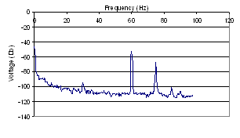
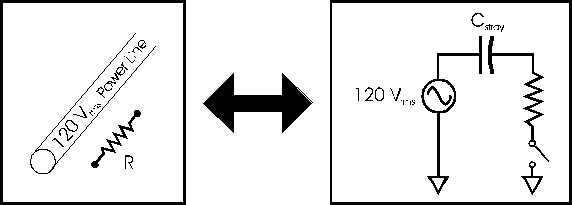
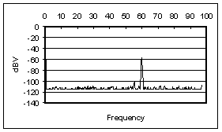
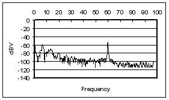
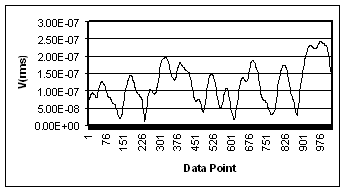

Source: <http://experimentationlab.berkeley.edu/IntroductiontoNoise>

**All pages in this lab**

1.  [Low Light Signal Measurements](http://experimentationlab.berkeley.edu/LLS)
2.  [Introduction to Equipment (LLS)](IntroductiontoEquipment.md)
3.  **Introduction to Noise**
4.  [Measuring the Light Signal from a Diode](LightSignal.md)
5.  [Appendix A: SR760 FFT Interface Program](LLS-Appendix-A-SR760-FFT-Interface-Program.md)
6.  [Appendix B: SR830 Lock-In Interface Program](LLS-Appendix-B-SR830-Lock-In-Interface-Program.md)
7.  [Appendix C: the Remote Control Box](LLS-Appendix-C-the-Remote-Control-Box.md)
8.  [Appendix D: the Phase Sensitive (Lock-In) Detector](LLS-Appendix-D-the-Phase-Sensitive-Lock-In-Detector.md)
9.  [Appendix E: Interpreting the Data Sheet for the LED](LLS-Appendix-E-Interpreting-the-Data-Sheet-for-the-LED.md) and [Photodiode Data Sheet](LLS-Diode-data-sheets.md)

-----

**Contents**

  - [1 Introduction To Noise](#introduction-to-noise)
      - [1.1 Intrinsic (Random) Noise Sources](#intrinsic-random-noise-sources)
      - [1.2 Before you begin this section . . .](#before-you-begin-this-section---)
      - [1.3 Other references](#other-references)
  - [2 $\frac{1}{f}$ Noise](#frac1f-noise)
      - [2.1 Experiment VI](#experiment-vi)
  - [3 Capacitive Coupling Noise](#capacitive-coupling-noise)
      - [3.1 Notes:](#notes-1)
      - [3.2 Exercise I (From Building Scientific Apparatus)](#exercise-i-from-building-scientific-apparatus)
      - [3.3 Experiment VII](#experiment-vii)
  - [4 Microphonic Noise](#microphonic-noise)
      - [4.1 Exercise II:](#exercise-ii)
      - [4.2 Experiment VIII](#experiment-viii)
  - [5 Shot Noise](#shot-noise)
      - [5.1 Exercise III](#exercise-iii)
  - [6 Instrument Noise](#instrument-noise)
  - [7 Johnson Noise](#johnson-noise)
      - [7.1 Exercise IV](#exercise-iv)
      - [7.2 Experiment IX](#experiment-ix)
          - [7.2.1 Notes](#notes-1)
          - [7.2.2 Procedure](#procedure)
          - [7.2.3 General comments about getting low-noise signals.](#general-comments-about-getting-low-noise-signals)

# Introduction To Noise

Noise plagues everything. Sometimes it can be so small compared to the signal of interest that it doesn't matter. This is not usually the case). Often different potential sources of noise must be taken account of so that noise can be avoided or even eliminated through experimental design or measuring techniques. In this section, you will learn about and explore the following types of noise:

## Intrinsic (Random) Noise Sources

1.  **$\frac{1}{f}$ Noise:** Higher noise amplitude at low frequencies. This noise makes low frequency measurements more difficult. Its origin is poorly understood. You should learn to recognize it and its effects on measurements.
2.  **Capacitive Coupling Noise:** AC voltages from nearby electronics create stray capacitive effects. Careful design can nearly eliminate capacitive noise.
3.  **Microphonic Noise:** Mechanical vibrations/movements affect the electronic components. Shaking a cable = microphonic noise.
4.  **Shot Noise:** Non-uniformity in the electric current due to the quantization of charge carriers. Since Shot Noise depends on frequency bandwidth, the Lock-in will be able to eliminate most of this noise.
5.  **Input Noise of Instruments:** Aggregate noises of many components in an instrument. Proportional to square root of bandwidth.
6.  **Johnson Noise:** Voltage noise across a resistor due to thermal fluctuations in the electron density. Called "white noise" because it's the same for all frequencies.

## Before you begin this section . . .

Read the blurb on different noise sources in the SR830 Lock-In Operating Manual (starting on page 3-21).

## Other references

1.  Moore, Davis and Coplan, *Building Scientific Apparatus*. It is a little more detailed than the SR830 Operating manual; a good reference for just about anything, not too advanced.
2.  M. J. Buckingham, *Noise in Electronic devices and Systems* . Its treatment is exhaustive and rather advanced. Unless you groove on ugly math, you'll probably only find the semi-qualitative introductions useful.
3.  Kogan, *Electronic Noise and Fluctuations in Solids*. It's also quite advanced--yet filled with all sorts of good information.

# $\frac{1}{f}$ Noise

  - From *Noise in Electronic Devices and Systems*

<!-- end list -->

1.  The origin of $\frac{1}{f}$ noise is poorly understood. However, you should learn to recognize it and its effects on measurements.
2.  Its spectral density (noise power /unit frequency interval) varies as $\frac{1}{f^{\alpha}}$, where $\alpha$ typically varies from 0.8 to 1.4 (depending on the material) and is more or less constant over large frequency ranges.
3.  $\frac{1}{f}$ noise has been observed from 10-6 Hz up to 106 Hz and higher.
4.  $\frac{1}{f}$ noise exists in practically all electronic devices, metal films, whiskers, liquid metals, electrolytic solutions, thermionic tubes, superconductors, and Josephson junctions. Buckingham also claims that it exists in many types of music, the measurements of the flood levels of the river Nile, the normal human heartbeat and neuro-membranes (p. 144).
5.  Other names include: current noise, excess noise, flicker noise, semiconductor noise, and pink noise (don't ask me...).

## Experiment VI

This experiment is mostly qualitative. You're basically going look at the $\frac{1}{f}$ noise across your fingers and say, "That's $\frac{1}{f}$ noise."

1.  Turn on the SR760 FFT (don't forget to press the back arrow \[$\leftarrow$\] button so that the SR760 resets to the default settings). We'll be using the FFT so we can verify the $\frac{1}{f^{\alpha}}$ spectrum.

2.  Start the *LowLight FFT Interface* program

3.  The window pops up asking you to chose between the \[ SCREEN CAPTURE \] and \[ MAKE SETTINGS REMOTELY \]. The first one means that the program will automatically download the data to the computer and the second option will let you choose and specify various parameters. Click on \[ MAKE SETTINGS REMOTELY \].

4.  We want to measure the voltage spectrum across your body in the 0 to 97.5 Hz range (it's most noticeable in that range as its spectral density goes like $\frac{1}{f}$). To do this input the following parameters in the program:

    1.  SPAN = 97.5 Hz
    2.  LINEAR AVERAGING: Under Advanced Options, choose Linear Averaging. (The Fourier components of the $\frac{1}{f}$ noise will fluctuate randomly, so at any instant it won't look like a $\frac{1}{f}$ spectrum. However, if we average several decompositions together, it will make itself apparent.)
    3.  AVERAGING TYPE = RMS
    4.  \\\# AVERAGES = 1000, ON
    5.  Click \[ SET PARAMETERS \] and the window will ask you if you want to save the data. Make your choice and the program will start acquiring the data.

5.  Connect a cable to INPUT A of SR760. Grab the cable and place your thumb over the end. Hold on until the data have been taken.

6.  Your data should look like ***Figure 1***. Does this follow a $\frac{1}{f^{\alpha}}$ spectrum? Note that the vertical axis is a log scale. Why does the spectrum seem to diverge at **f = 0 Hz?**  
    

    Figure 1

7.  Now do the same thing, only change the Span to 195 Hz.

8.  As before, to make another data transfer you do not need to restart the program. There are two choices. One, click on the arrow in the upper left corner (note: this arrow only shows up if you have already transferred the data at least once.) Another choice is to choose \[ RUN \] from the OPERATE menu option. With either choice you will be asked to chose between \[ SCREEN CAPTURE \] or \[ MAKE SETTINGS REMOTELY \].

9.  Now what do you see? At what frequency range does flicker noise seem to dominate? Where does it disappear relative to the noise floor (the background noise at high frequencies)?

# Capacitive Coupling Noise

AC voltages from nearby electronics create stray capacitive effects. Careful design can nearly eliminate capacitive noise.

## Notes:

  - **Frequencies to be wary of:**
      - 60/120 Hz and harmonics
      - AM broadcasts at 0.5 to 2 MHz
      - CB radio around 30 MHz
      - FM and TV bands at around 100 MHz
      - Radar and Microwave around 10 GHz
  - **Sources of Capacitive noise**
      - Other parts of the circuit in question
      - Power lines/cords etc.
      - Automobile ignition systems
      - Microwave ovens
      - Electrical discharges
      - Electric motors
      - Electromechanical switches and relays

## Exercise I (From Building Scientific Apparatus)

Estimate the minimum stray capacitance, $C_{min}$,needed to induce a 1 *m*Vrms voltage across a 1 M$\Omega$ resistor from a 120 Vrms power line (*f* = 60 Hz). *Hint: Use the model below:*

Figure 2

Is this a large capacitance? Keep in mind that the capacitance of one foot of RG/58 coaxial cable is 33 pF.

## Experiment VII

*Now you get to explore capacitive noise\! This is mostly a qualitative experiment in which you play with dangling inputs and see just how much noise can be induced in a typical lab environment. It is at this point that you get to change those annoying 60/120 Hz peaks\!*

1.  Turn on the SR760 FFT and start the *LowLight SR760 Interface* program.
2.  Pick \[ MAKE SETTINGS REMOTELY \]
3.  Hook up a coaxial cable to INPUT A of the SR760 and let it lie on the table (unterminated).
4.  Use the default settings of the *LowLight SR760 Interface* program (i.e. SPAN = 1.56 kHz, etc.) and take a data run. Save the data and include it in your lab write-up.
5.  **What do you see? Explain the existence of the different peaks. Speculate why there are harmonics on the fundamental. Do you see any $\frac{1}{f}$ noise?**
6.  Let's get a better look at that 60 Hz noise. Take another data run, only this time set the SPAN to 97.5 Hz. Include this data run in your lab write-up, also.
7.  To get an idea as to how much noise is really being induced in the cable, measure and record the height of the peak centered on 60 Hz (you can either do this with the interface program or with the SPIN KNOB on the FFT (make sure you hit the \[ MEAS \] button first, though).
8.  Does the orientation of the cable affect the magnitude of the induced noise? Experiment with different orientations of the unshielded cable (e.g. lying flat on the table vs. hanging straight down, etc). **Explain what you see.**
9.  Now coil the cable up. **What happens to the 60 Hz peak** (Look at the FFT screen.) Stuff the coiled cable into the brass tube provided. **Again, what happens to the 60 Hz peak? Measure and record the magnitude of the 60 Hz peak for both cases.** (Use either the FFT or the interface program-see (6) above.)
10. With the cable stuffed in the brass tube, ground the brass tube (the instrument rack should suffice as a ground). There should be some clips hanging from the ring stand by the computer. **What happens? Again, measure the height of the peak**. Include in your write-up a plot of the data with the grounded brass tube around the cable.
11. **Compare the magnitudes of the peaks in units of *volts* (not dBV).** **Explain why coiling the wire reduces the noise, why shielding the cable reduces it some more, and why grounding the shield reduces it even further.**

Now you see why sensitive experiments are usually locked up in a Faraday Cage. Other common ways to eliminate Capacitive noise include:

  - Using tri-axial cable. Tri-axial cable is basically co-axial cable with an extra metal braid around it.
  - Removing the annoying noise source
  - Using low (high) impedance for voltage (current) measurements. ***\*\*\*Explain why this works\*\*\****
  - Keep lines close to ground and away from fringing fields.

# Microphonic Noise

## Exercise II:

Estimate the magnitude of the Microphonic noise caused by shaking one meter of RG/58 coaxial cable at a frequency of 10 kHz. Assume that:

  - The cable has 1 V across it and a capacitance of 33pf/foot.
  - It goes into a scope with a 1 M$\Omega$ input impedance
  - The shaking causes a change in capacitance ($\delta C$) of 1 pF (does this sound reasonable? What is $\frac{\delta C}{C}$?)

## Experiment VIII

This experiment is almost completely qualitative. You'll look at some Microphonic noise on the FFT. The source will be a dangling input, which you will shake by hand.

1.  Turn on the SR760 FFT and start the ***LowLight SR760 Interface*** program.

2.  Since you'll be providing the Microphonic action (i.e. shaking the cable), you probably won't need to look at the frequency spectrum above 100 Hz-unless you're a super-duper tambourine player. So set the SPAN to 97.5 Hz using the ***Interface*** program. Also turn LINEAR AVERAGING off, if it is on (you'll want to track the happenings in real time, as the frequency of your shaking will probably vary a little).

3.  Hook up a coaxial cable to INPUT A and let it cable hang still. Using the ***Interface*** program, take a set of data points. Look at the spectrum. You should see something as in ***Figure 3***. Note the $\frac{1}{f}$ and capacitive noise. Include a copy of these data in your lab write-up.  
    

    Figure 3: Without Shaking the Cable

4.  Now shake the cable at a semi-constant frequency (*Note: you don't have to go crazy. You're not trying to kill snakes or anything. Just shake it gently*). **Comment on what happens on the FFT screen.** Using the ***Interface*** program, take a set of data while shaking the cable. Your data should look something like ***Figure 4***.  
    

    Figure 4: Shaking the Cable

    Notice how large harmonic components appear around the frequency that you're shaking the cable. **Why are there multiple peaks? Why are they broad?** Notice how a little bit of shaking can produce noise that easily matches the Capacitive pick-up at 60 Hz. Also note how it is harder to isolate non-affected frequencies (i.e. the noise is spread out over a large band of frequencies, not just peaked at 60 Hz or so).

5.  Explore the Microphonic noise effects using different values of the SPAN. You don't need to use the *Interface* program to save these data points. Just adjust the SPAN using the SPIN KNOB on the FFT. **Comment on anything you find interesting**.

6.  **List some ways to avoid Microphonic Noise.**

# Shot Noise

  - It is a form of *white noise*, noise that has the same power density at all frequencies.
  - At a given frequency, the voltage fluctuations are gaussian in nature (i.e. if you plotted a histogram of voltage measurements at any specific frequency at a number of equally spaced times, it would be gaussian in shape).
  - Note: When using instruments such as the SR830, the bandwidth is given by the ENBW (Effective Noise Bandwidth), specified in the manual (page 3-11 in the SR830 manual). This applies to all forms of Gaussian noise.

## Exercise III

Calculate the shot noise for the Pin-10DP Pin Diode in units $\frac{A}{\sqrt{Hz}}$. These units may seem peculiar, but they are in universal use. We really want the power/unit frequency interval, which is the square of the units that are used. Notice how the shot noise increases with increasing signal current. If we wanted to recover our signal better, and our only concern was shot noise, would we want a higher or lower signal current? For what value of the signal current would the signal and shot noise currents be equal?

*At this time, there is no experiment for shot noise.*

# Instrument Noise

When you stop and think about the many resistors and other components inside instruments, it's not surprising that they are also sources of noise. The noise added to the signal is usually proportional to $\sqrt{\triangle f}$, where $\triangle f$ is the bandwidth. To get an idea of how big these noise sources are, refer to:

  - ***SR830*** Lock-In Manual, p. (3-17). Input noise \~ $\frac{5nV_{rms}}{\sqrt{Hz}}$
  - ***SR570*** Current Preamplifier Manual, p. vii. Input noise ranges from $\frac{150pA}{\sqrt{Hz}}$ to $\frac{5fA}{\sqrt{Hz}}$. *Note: to get this as an output noise in Vrms, divide it by the SENSITIVITY.*

<!-- end list -->

1.  Note: When using instruments such as the ***SR830***, the bandwidth is given by the ENBW (Effective Noise Bandwidth), specified in the manual (page 3-11 in the ***SR830*** manual). This applies to all forms of Gaussian noise.

*There is no exercise or experiment for instrument noise.*

# Johnson Noise

(Read p. 458 of *Building Scientific Apparatus*)

  - It arises from statistical fluctuations in electron motion in a resistor at finite temperature. It can be derived using ideas based on Black Body radiation. For a derivation, see *Thermal Physics* by Kittel, p. 98.
  - At a given frequency, the voltage fluctuations are Gaussian in nature (i.e. if you plotted a histogram of voltage measurements, it would be Gaussian)
  - It is *white noise*-i.e. exists at all frequencies with the same magnitude. So the more frequencies you sample, the more Johnson noise you get.
  - Johnson noise also presents itself in the form of a current: $I_{J, rms}^2=\frac{V_{J, rms}^2}{R_{source}^2}=\frac{4kT\triangle f}{R_{source}}$
  - It is independent of material-everything with the same resistance has the same Johnson noise.
  - The units $\frac{V}{\sqrt{Hz}}$ and $\frac{A}{\sqrt{Hz}}$ appear a lot in the noise business (usually in the context of *white noise*). In order to actually get a value for the noise, you'll need to multiply the quoted value by $\sqrt{\triangle f_b}$, where $\triangle f_b$ is the bandwidth of your measurement.
  - Note: When using instruments such as the SR830, the bandwidth is given by the ENBW (Effective Noise Bandwidth), specified in the manual (page 3-11 in the SR830 manual). This applies to all forms of Gaussian noise.

## Exercise IV

Calculate the Johnson current noise for the Pin-10DP Pin diode. Express your answer in $\frac{V}{\sqrt{Hz}}$. Would you want a current signal to come from a high impedance source or a low impedance source if you were concerned about Johnson noise? What if it were a voltage source? Why?

## Experiment IX

### Notes

In this experiment, you will use the SR830 Lock-In to measure Johnson noise and its dependence on $R_{source}$ and $\triangle f_b$ by hooking up various resistors across the input of the SR830. *Note: Compared to the previous small experiments, this is rather involved.*

**A former student makes these comments:**

*Reasons for using the spectral analyzer are:*

  - You get a picture of what the entire noise spectrum looks like, instead of just some number. You aren't taking a "shot in the dark" and can avoid hitting a noise peak. There are other peaks besides the 60 Hz harmonics.
  - The SR760 can tell you the noise power at a point as well as within a bandwidth.
  - You can press a few buttons and get an answer really fast.
  - You get a better "feel" of whether or not your answer makes sense.
  - You get better answers because the scope takes more averages.
  - The Lock-in Lab-View program occasionally gives totally wacky values.

*Reasons for using the Lock-in to take measurements after using the spectrum analyzer to take a look at the noise are:*

  - You get to use some of the "effective bandwidth" stuff you learned earlier.
  - There is slightly more physics involved, as you can actually see some of the voltage fluctuations.

### Procedure

1.  Turn on the SR830 Lock-In and start the *SR830 Lock-In Interface* program.
2.  Via a coaxial cable, hook up a pair of clips to the INPUT A/I of the Lock-In. Make sure that the cable is short and stiff. **Why is this important?**
3.  Unplug any input to the REF IN. You will use the Lock-In's internal oscillator as a reference.
4.  Since you're using the internal oscillator, you'll have to choose and set the frequency of oscillation manually:
    1.  Depress the \[ SOURCE \] button by the SPIN KNOB until INTERNAL is chosen. This tells the SR830 that you'll be using the internal oscillator as a reference signal.
    2.  Depress the \[ FREQ \] button above the SPIN KNOB. This will allow you to choose the frequency of oscillation.
    3.  Turn the SPIN KNOB until the desired frequency set. Make sure to choose the frequency wisely so as to eliminate as much non-Johnson noise as possible. **Record your frequency choice and reasons for choosing it.**
5.  Connect a 100 $k\Omega$ resistor across the clips. Set the TIME CONSTANT to 30 ms and adjust the SENSITIVITY appropriately. Also, select the highest SLOP/OCT rolloff, 24 dB. Use the "Low noise" setting and NOT "High reserve".
6.  Input the following settings on the ***Interface*** program:
    1.  Data Run and Save Options
          - NUMBER OF RUNS: 7 (the more measurements, the better)
          - SAVE DATA?: Yes (box checked) (include in your lab write-up the analyzed data in table format and a plot of the raw data)
          - SAVE DATA TO: *You decide*. For your purposes, one file would probably be just fine. It is recommended that you include information relevant to the measurement, such as the value of the resistor, and the SLOP/OCT rolloff.
    2.  Data Acquisition Options
          - GPIB ADDRESS: 8 (That's where the SR830 lives in the wonderful world of GPIB and you do not change it.)
          - SAMPLE MODE: BEST CHOICE is recommended. *Note: Sometimes taking more than 1200 data points doesn't work. If this happens, consider using the* BEST CHOICE *mode while selecting the* TIME CONSTANT*. This way, the computer will choose an appropriate* SAMPLE RATE *for you. Then switch to* CUSTOM *mode and adjust the* SPAN *so as to reduce the* TOTAL NUMBER OF DATA POINTS *below 1200.*
          - TIME CONSTANT: 30 ms
          - Press \[ START \].
7.  Let the ***Interface*** program take the data for you. Watch to make sure that you're getting good data. Things to look out for:
    1.  **All of your data are zero or some other constant value**. A possible problem is that the Sensitivity isn't adjusted correctly or that it is overloaded.

    2.  **Some of your data are zero**. Perhaps you need to reduce the TOTAL NUMBER OF DATA POINTS below 1200.

    3.  **The data look very "spiky". WHY IS THIS A PROBLEM (this is a question for you to answer)?** The SAMPLE RATE is probably too low. Increase it. Your data should look rather rounded and contain as many "periods" as possible. See ***Figure 5.***  
        

        Figure 5: The data aren't "spiky" and have quite a few "periods"

    4.  The data don't have many "periods." **WHY IS THIS A PROBLEM (this is a question for you to answer)?** The SAMPLE RATE may be too high. Decrease it, keeping in mind the tradeoff with "spikiness", above.
8.  It should take just a minute or two for the ***Interface*** program to collect, analyze, and save the data. Open the file "**\[*base file path*\] Analyzed Data (T= \[*time constant*\] ).xls**" in Excel. You should see something like the following (note, this sample only represents 3 data runs using a resistor that was not 100 k$\Omega$):

| \<R\>    | \<dR^2\>^1/2 | \<dR\>   |
| -------- | ------------ | -------- |
| 1.18E-07 | 5.73E-08     | 4.79E-08 |
| 1.64E-07 | 6.81E-08     | 5.19E-08 |
| 1.52E-07 | 6.71E-08     | 5.54E-08 |

9\. Find the average value of your ${\left \langle \triangle R^2 \right \rangle}^{\frac{1}{2}}$ measurements and compare it to the theoretical value (remember: *R* stands for magnitude of the measurement made by the Lock-In). Is your measurement off by about a factor of $\sqrt{2}$? **If it is, why**?

10\. Repeat the above procedure for TIME CONSTANT values of 100 msec., 300 msec., 1 sec., and 3 sec. *Note: taking data at high TIME CONSTANT values will take a long time. You can let it run overnight or while you go to get lunch, if you want.*

11\. To see how the Johnson Noise varies with resistance, repeat the above procedure using a 10$k\Omega$ resistor.

12\. Compile all your data and plot them. **How well do they agree with theory (remember to calculate $\triangle f$ using the ENBW specified on page 3-11 of the SR830 manual)? What would you expect for such a crude experiment? Remember to account for the Lock-In input noise**: $\Large V_{Tot, noise}^2=V_J^2+V_{Input}^2$.

### General comments about getting low-noise signals.

There are three techniques that you can use to reduce the amount of noise in your signal. The first is using shorter cables. The shortest "cable" is a male BNC barrel connector. The second is using "differential inputs, which you can read about on pages 3 to 19 in the SR830 manual. In brief, you can use two cables to measure the signal so that the noise common in both cables cancels out. These two techniques reduce the external noise. The third is running your experiment at low temperatures. After finishing this section, you might dunk your resistor in liquid nitrogen to see how it affects the intrinsic (Johnson) noise of the resistor. Just be sure to note R as a function of T, and don't get the inputs on the equipment cold, or water could condense on them.
