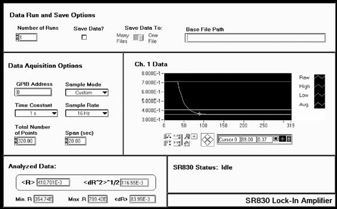

Source: <http://experimentationlab.berkeley.edu/node/97>

**All pages in this lab**

1.  [Low Light Signal Measurements](http://experimentationlab.berkeley.edu/LLS)
2.  [Introduction to Equipment (LLS)](IntroductiontoEquipment.md)
3.  [Introduction to Noise](IntroductiontoNoise.md)
4.  [Measuring the Light Signal from a Diode](LightSignal.md)
5.  [Appendix A: SR760 FFT Interface Program](LLS-Appendix-A-SR760-FFT-Interface-Program.md)
6.  **Appendix B: SR830 Lock-In Interface Program**
7.  [Appendix C: the Remote Control Box](LLS-Appendix-C-the-Remote-Control-Box.md)
8.  [Appendix D: the Phase Sensitive (Lock-In) Detector](LLS-Appendix-D-the-Phase-Sensitive-Lock-In-Detector.md)
9.  [Appendix E: Interpreting the Data Sheet for the LED](LLS-Appendix-E-Interpreting-the-Data-Sheet-for-the-LED.md) and [Photodiode Data Sheet](LLS-Diode-data-sheets.md)

-----

**Contents**

  - [1 Instructions for LLS SR830 Lock-In Interface Program](#instructions-for-lls-sr830-lock-in-interface-program)
      - [1.1 Data Run and Save Options](#data-run-and-save-options)
      - [1.2 Data Acquisition Options (refers to each run)](#data-acquisition-options-refers-to-each-run)
      - [1.3 Analyzed Data](#analyzed-data)
      - [1.4 SR830 Status Ring](#sr830-status-ring)
      - [1.5 Ch. 1 Data Plot](#ch-1-data-plot)

# Instructions for LLS SR830 Lock-In Interface Program

Shown above is a screen capture of the SR830 Interface Program. Following are descriptions of the various controls and displays grouped according to their location on the front panel.

## Data Run and Save Options

  - **Number of Runs Control**: Specifies the number of runs the Lock-In is to complete.
  - **Save Data? Check Box:** If the box is checked, each data run will be saved at the end of the data run in a spreadsheet-ready file (tab delimited). If more than one run is to be performed, the data will automatically be saved.
  - **Save Data To Switch**: Selects whether or not each data run will be saved in its own file or if all the raw data will be saved to the same file. Note: The processed data (i.e. ) will always be saved to one file.
  - **Base File Path**: Displays the base file path. After entering the Data Run and Save Options, you will be asked for a base file path if the **Save Data** option was checked. What the base file path does:
  - Raw data saved to one file will be saved under the file name:

**\[*base file path*\] (T = \[*time constant* \] ).xls**

  - Raw data saved to multiple files will be saved under file names of the form:

**\[*base file path*\] (T = \[*time constant*\] Run \[*run number* \] ).xls**

  - Analyzed data will be saved under the file name:

**\[*base file path*\] Analyzed Data (T = \[*time constant* \] ).xls**

## Data Acquisition Options (refers to each run)

  - **GPIB Address Control**: Specifies the GPIB address of the SR830. Unless it is manually changed on the SR830, it should be 8.
  - **Sample Mode Ring**: Selects which mode will be chosen.
  - *Custom* mode allows the user to set both the *time constant*, *sample rate*, and *span* as desired (unless the total number of data points exceeds 1400).
  - *Best Choice* allows the user to select only the *time constant*. The Interface program will then automatically set the sample rate (about $\large \frac {10}{Time Constant}$) and the *span* (adjusts it so that 1400 data points are taken).
  - **Span Control**: Determines how long, in seconds, the SR830 will collect data for each run.
  - **Total Number of Points Display**: Displays the total number of points the SR830 will collect during each run.

## Analyzed Data

  - **\<R\> Display**: Displays the average value of R ($\bar {R}$) for the latest set of data.
  - **\<dR^2\>^1/2 Display**: Displays the *rms* deviation of R for the latest set of data. I.e.

$\large \left \langle dR^2 \right \rangle^{1/2} \leftrightarrow \sqrt {\frac {1}{N} \sum_{i=1}^N (\bar{R}-R_i)^2}=\sqrt {\bar{R}^2 - \bar{R}^2}$

  - **Min. R Display**: Displays the smallest value of R in the latest set of data.
  - **Max. R Display**: Displays the largest value of R in the latest set of data.
  - ***\<dR\> Display***: Displays the average deviation from \<R\>. I.e.

$\large \left \langle dR \right \rangle \leftrightarrow \frac {1}{N} \sum_{i=1}^N \left | R-\bar{R} \right \vert$

## SR830 Status Ring

Displays the status of the SR830, the Interface program, and their link. The messages are pretty self-explanatory. During data acquisition, a fill slide will display the progress of data acquisition.

## Ch. 1 Data Plot

  - The plot will display the most recent data points in cyan, the average value of the data in green, and the high and low values in dark blue.
  - The cursor control allows the user to investigate the raw data values. To use it, click on the \[+\] key on the control palette. For more information on plot displays, see *LabView for Everyone*.
  - The x-axis has units of data point number, while the y-axis has units of Volts.
