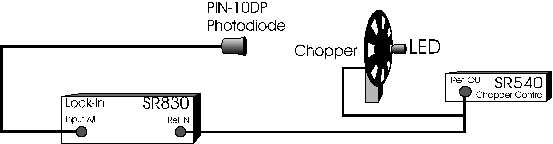
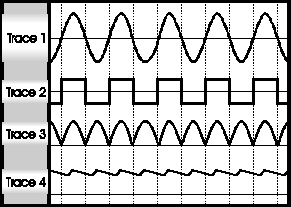
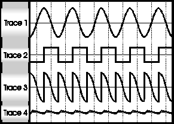
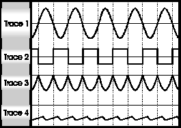

Source: <http://experimentationlab.berkeley.edu/node/99>

**All pages in this lab**

1.  [Low Light Signal Measurements](http://experimentationlab.berkeley.edu/LLS)
2.  [Introduction to Equipment (LLS)](IntroductiontoEquipment.md)
3.  [Introduction to Noise](IntroductiontoNoise.md)
4.  [Measuring the Light Signal from a Diode](LightSignal.md)
5.  [Appendix A: SR760 FFT Interface Program](LLS-Appendix-A-SR760-FFT-Interface-Program.md)
6.  [Appendix B: SR830 Lock-In Interface Program](LLS-Appendix-B-SR830-Lock-In-Interface-Program.md)
7.  [Appendix C: the Remote Control Box](LLS-Appendix-C-the-Remote-Control-Box.md)
8.  **Appendix D: the Phase Sensitive (Lock-In) Detector**
9.  [Appendix E: Interpreting the Data Sheet for the LED](LLS-Appendix-E-Interpreting-the-Data-Sheet-for-the-LED.md) and [Photodiode Data Sheet](LLS-Diode-data-sheets.md)

-----

*Originally written/prepared by J. Stoltenberg and O.E. Vilches, University of Washington, September, 1995. Revised for use in the 111 Labs in September 1997.*

# Recommended reading:

1.  P. Horowitz and W. Hill, *The Art of Electronics,* 2nd ed., Cambridge University Press, New York, NY, 1989, pp. 430-436 (noise in general), pp. 1026-1035 (bandwidth narrowing and lock-in detection).
2.  D. Preston and E. Dietz, *The Art of Experimental Physics,* Wiley, New York, NY, 1991, pp. 367-375 (lock-in detection in general and modulation technique applied to spectroscopy measurements).
3.  SR830 DSP Lock-In Amplifier Operating Manual, SR830 Basics section.

# Introduction to the Phase Sensitive (Lock-In) Detector

Many measurements in experimental physics involve the detection of an electrical quantity, either a voltage or a current. Some physical quantities are intrinsically electrical in nature, for example the voltage drop across a diode, or the emission current in a vacuum tube. Other quantities such as temperature, pressure, displacement, or light level; can be converted to electrical quantities by means of transducers (sometimes called sensors). Unfortunately, the electrical quantity or signal of interest is always accompanied by noise, which is sometimes orders of magnitude larger than the signal. Various techniques exist to recover the signal of interest from the composite of signal + noise, and one technique, phase sensitive (lock-in) detection will be explored in this exercise.

Before plunging into this exercise, consider the following question: Can we reduce the noise content of an electrical signal coming from a transducer to arbitrarily low levels by being sufficiently careful and clever? The answer, in a word, is no. The signal from any transducer with resistive or diode-like characteristics will, from physical principles, have an irreducible amount of (Johnson or shot) noise on its output signal. In addition, some kind of reducible noise ($\frac {1}{f}$, electromagnetic interference, microphonic, to name a few) is almost always present in the transducer output, buttressing the claim that noise will be present at some level on any transducer signal. Finally, just amplifying the composite signal won't help make the signal of interest more distinguishable from noise, since amplifiers boost the level of everything present at the input, noise included, and contribute noise of their own to boot\! For a discussion of the various kinds of electrical noise, see Horowitz, pp. 430-436.

The key to recovering successfully the desired signal from a noisy composite, is to give the desired signal some unique characteristic enabling us to selectively detect it while rejecting most of the noise. This uniqueness is often achieved by making the desired signal periodic at some frequency fm, and then tuning the detection system to pass signals at this frequency while rejecting signals at all other frequencies. In essence, the detection system need to act as a highly frequency-selective voltmeter or ammeter, and indeed the phase sensitive detector does just this.

Before discussing how a phase sensitive detector works, it is useful to describe a typical application. In the LowLight experiment, we are trying to measure the intensity of the light emitted by an LED in the presence of room lights and sunlight. To do this, we chop the light from the LED at a frequency fmwith a chopper wheel (see diagram below). Across the room is a photodiode (a transducer\!) which converts light intensity into a current. In this way, the light from the LED, room lights, and sun are converted into a current signal, which is ultimately sent into a phase sensitive detector. The phase sensitive detector then takes this signal and discards the part that is not at frequency fm, thus recovering the signal from the LED (assuming that none of the other light sources also had frequency components at frequency fm)

How does the lock-in know to detect the part of the input signal at frequency fm and reject all other frequencies? By virtue of a second input signal, also at frequency fm, applied to the Reference input of the lock-in. In the LowLight experiment, the reference signal comes from the device that chops the LED signal. At the end of the signal detection and conditioning process, the lock-in output is a DC voltage proportional to the amplitude of the component of the input signal at fm., multiplied by the cosine of the phase angle $\phi$ between this signal and the reference signal. The origin of this $\cos {\phi}$ factor will become clear in the discussion of how the phase sensitive detector works. One last detail: there is some noise on the lock-in output-you can never get away from it completely\! From what has been said so far about the phase sensitive detector, you might think that it does its job by first filtering out all signals except the one of interest at frequency fm, and then rectifying (converting AC to DC\_ the filtered signal to produce a steady DC output. In practice this arrangement doesn't work very well, It is difficult to construct a filter which passes only a narrow range of frequencies, and it is difficult to keep a filter tuned exactly to the frequency of interest. The phase sensitive detector makes an elegant end run around these problems by reversing the order: it first rectifies the signal and then filters it. Let's see how this is done.

Figure 2: Basics of a Phase Sensitive Detector

***Figure 2*** shows the guts of a basic phase sensitive detector. The switch is designed so that is spends an equal amount of time in each position. If the switch changes from lower to upper positions just as the input sine wave crosses from negative to positive, the signal at point A will be as shown in ***Figure 3***, trace 3 (trace 1 is the input signal, trace 2 is the reference signal, and trace 4 is the signal at A smoothed out by the low-pass filter). If the time constant $\tau$ (=*RC* ) of the low pass filter is much greater than the period of this signal $\frac{1}{f_m}$, the filter output will be a smooth DC voltage (*see ''***Figure 3''***, trace 4* ).

Figure 3

  - Figure 3: $\phi=0^\circ$
  - Trace 1: Input Signal; Trace 2: Reference Signal; Trace 3: Rectified Input Signal; Trace 4: Rectified Signal after the Low Pass Filter at B (as shown in Figure 2). Note the ripple in the voltage.

Figure 4

  - Figure 4: $\phi=90^\circ$
  - Trace 1: Input Signal; Trace 2: Reference Signal; Trace 3: Voltage at A (as shown in Figure 1); Trace 4: Voltage at B (as shown in Figure 2).

Figure 5

  - Figure 5: $\phi=180^\circ$
  - Trace 1: Input Signal; Trace 2: Reference Signal; Trace 3: Rectified Signal at A (as shown in Figure 1); Trace 4: Output Signal at B (as shown in Figure 2).

What if the switch changes from lower to upper positions just as the sine wave input reaches a maximum? The signal at point A now looks like that in ***Figure 4***, trace 3. The average of this signal is clearly zero and it will not contribute to the DC output level.

If the switch changes from lower to upper positions just as the sine wave crosses from positive to negative the signal at point A will be as shown in ***Figure 5***, trace 3. The output will be a negative voltage equal in magnitude to the positive output voltage for the case in ***Figure 3***.

As indicated earlier, the purpose of the low pass filter is to pass the DC part and smooth out, or average, the AC part of the signal at point A.

$\Large V_{out, average}=\frac{1}{T_m}\left [\int_{0}^{\frac{T_m}{2}}V_0\sin[\omega_mt+\phi]\, dt - \int_{\frac{T_m}{2}}^{T_m}V_0\sin[\omega_mt+\phi]\, dt\right ]$

$\Large = 2\frac{V_0}{\pi}\cos{\phi}$

where the input signal is assumed to be of the form

$\Large V_0\sin{[\omega_mt+\phi]}$,

and $\Large \omega_m=2\pi f_m$,

$\Large T_m=\frac{2\pi}{\omega_m}$,

and $\phi$ is the phase difference between the input signal and the reference signal. The integral is split into two pieces to account for the effect of the switch. The origin of the name "phase sensitive detector" is now clear: this device detects not only the magnitude of the input signal, but also its phase relative to the reference signal.

Why does one have to worry about this factor $\cos{\phi}$? Why not just set $\phi=0$ and forget about it? To answer this in a specific case, consider the experiment mentioned earlier. The chopper system alternately blocks and passes (chops) the LED signal at a frequency fm by means of a rotating slotted disk. (The signal applied to the lock-in input is in phase with the passed LED signal). The chopper control unit provides the reference signal for the lock-in, and this signal is correlated to the position of the slots on the rotating disk. When the leading edge of an opening passes the fixed angle $\theta=90^\circ$, the reference signal goes high, and when the trailing edge passes $\theta=0^\circ$, the reference signal goes low ($\theta$ is measured about the axis of the chopper wheel). However, the spatial position of the LED is arbitrary relative to the chopper disk. The LED might be at $\theta=0^\circ, 15^\circ, etc.$-- it can be positioned anywhere to suit the needs of the experiment (so long as it passes through the slots). So the chopping system has no way of knowing when it is turning the LED signal on and off, with the result that signal does not necessarily turn on (become unblocked) at the same time the reference signal goes from low to high.

This is typical of the general situation: the experiment conspires to introduce a phase shift between the detected signal and the reference signal. Most lock-in amplifiers allow one to compensate for this by introducing a variable phase shift in the reference signal before it actuates the switch (the SR830 will do this automatically). By compensating for the phase shift in the experiment, $\phi$ is effectively set to 0 and the output signal maximized.

One last consideration before moving on to the hardware: what happens when the input signal frequency differs from that of the reference signal by an amount $\large \triangle f=\frac{\triangle\omega}{2\pi}$? In this case $\phi$ is not constant but varies in time,

$\large \phi=(\triangle\omega)t$.

The output of the low-pass filter (and of the lock-in) is now:

$\Large 2\frac{V_0}{\pi}\cos{[\triangle\omega t]}[1+(\triangle\omega RC)^2]^{1/2}$

The factor $\large [1+(\triangle\omega RC)^2]^{1/2}$ is always present and derives from how the voltage divides across the resistor and the capacitor. For $\triangle\omega=0$, this factor is 1, meaning that any DC input to the filter is passed unattenuated to the output.

We can now summarize the effect of the lock-in amplifier: all input signals are shifted downward in frequency by an amount equal to the reference frequency, with the frequency of interest appearing at the output as a DC (0 frequency\!) level, and all signals at other frequencies appearing as fluctuations at the difference frequency attenuated by an amount depending on the frequency difference $\triangle\omega$ and the time constant setting $\tau=RC$ of the lock-in amplifier. Simply put, the instrument "locks-in" to the signal at the reference frequency, and rejects, to varying degrees, all others.
