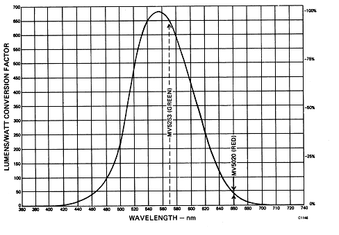

# Interpreting the Data Sheet for the LED

The data sheet for the LEDs may seem a little mysterious if you're not used to the units being used. The red LED that we are using has the model number MV5753.[Diode Data Sheet](http://physics111.lib.berkeley.edu/Physics111/Reprints/LLS/MV5753_LLS-2.pdf)

To determine the typical power output of the MV5753, we use the typical value of the Luminous Intensity. What is the Luminous Intensity? It's the amount of power fluxing through one Steradian (assuming a point-like source). So we look at the data sheet and see that for the MV5753 running with 20 *mA* of forward current, the Luminous Intensity is about 6 *mcd*.

So what's a *cd*? It's a unit called the *candella* (or *candle*, used loosly). One *candela* is equal to a $\large \frac{lumen}{Steradian}$, where a *lumen* is a unit of power. However, the conversion factor between *lumens* and *Watts* is a function of the wavelength of the light being discussed. For historical reasons, light intensity was measured with the eyeball and recorded in $\large \frac{lumens}{Steradian}$ (basically they didn't have photodiodes way back when. Why they continue to use this unit is a mystery to me). So to convert between the *lumen* and the *Watt*, we need to know the response of the human eye. The French have a "standard eyeball" curve, shown below (it's reproduced from *the General Instrument Catalog of Optoelectronic Products (1980)*).

Here's a sample conversion. Say we're talking about the MV5020, which emits (the minimum according to the data sheet) of radiation at 660 *nm*. Looking at the "eyeball" curve, we see that at this wavelength, one *Watt* is equivalent to 41.4 *lumens*. So to express the power of the MV5020 in *lumens*, we just crank out the math:

$\large (180\times10^{-6} Watts) (\frac{41.4 lumens}{Watt}) = 7.45\times10^{-3} lumens $

So, just to bring everything together, let's do another sample calculation. Say we want to find the typical power output of the MV5020 in *Watts,* given a typical luminous intensity of 2.0 *mcd*. Here's how it goes:

$\large P=2\times10^{-3}(\frac{lumens}{Steradian})(4\pi Steradians)$

$\large =8\pi \times10^{-3}(lumens)(\frac{1Watt}{41.4 lumens})=607\mu W $

Note that the luminous intensity was determined assuming a point source, so we're allowed to simply multiply by $4\pi$.
