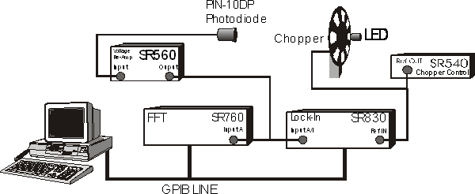
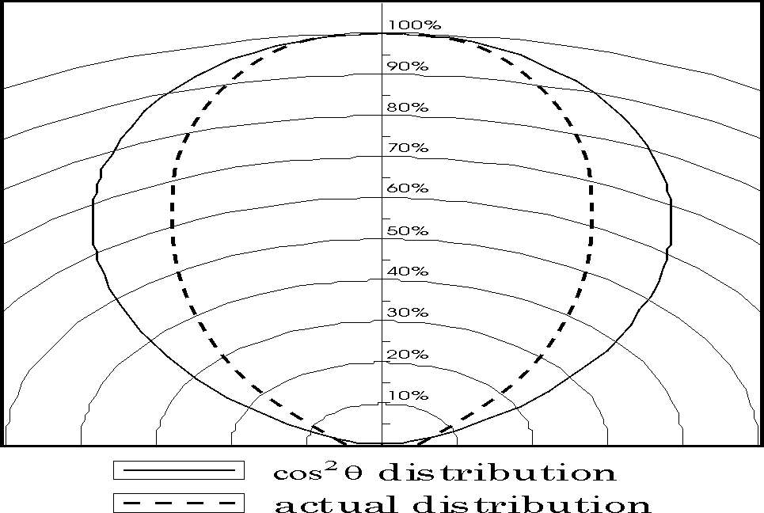

**Contents**

  - [1 Experimental Setup](#experimental-setup)
  - [2 Block Diagram I](#block-diagram-i)
      - [2.1 Exercise V](#exercise-v)
      - [2.2 Experiment X](#experiment-x)
      - [2.3 Experiment XI](#experiment-xi)
  - [3 Interpreting the Data](#interpreting-the-data)

# Experimental Setup

We are now ready to apply what we have learned. Our goal is to measure the light output of an LED using the 10DP Pin Diode. We'll complicate things by taking this measurement with a lot of background noise sources such as overhead room lights.

How should we go about taking such a measurement? We learned that if we can modulate our light source at a known frequency, we can use the SR830 Lock-In to recover any signal at that frequency. To do just this, we chop our light signal with a chopper wheel. In essence, we are turning our D.C. signal into an oscillating signal. In a typical setting, the chopper wheel slits are much larger than the light source-making a square wave. In this experiment, however, the chopper slits are just about the same size as the LED, so that we'll be stuck with something closer to a triangular wave. See **Figure 1**:

Figure 1

Using this technique, we can recover the LED signal even though there may be a lot of other light sources around.

# Block Diagram I

Figure 2: Block Diagram 1

Shown above in **Figure 2** is a block diagram for the experiment. The LED signal is chopped by the chopper, whose frequency is set by the SR540 Chopper Controller. The chopped signal is detected by the PIN-10DP photodiode, which sends a current signal to the SR570 Low-Noise Current Preamplifier. The SR570 amplifies, filters, and measures the input current signal and you convert it to an output voltage signal. The voltage signal is then sent to the SR760 FFT and the SR830 Lock-In Amplifier. The reference signal for the Lock-In is provided by the SR540. Finally, the computer gathers and analyzes the data.

You may be asking yourself, "why do we need to use the SR570? It just adds a bunch of noise to our signal\! It can't just be that the SR570 will convert the current signal to a voltage\! I read that the Lock-In can accept either a voltage or a current. So what is the purpose of the SR570?"

Well, it's true that the SR830 will accept an input current. If you read carefully, you'll notice that the maximum input DC current is 10$\mu A$ and the maximum input AC current is 1.4 $\mu A$. **Under our operating conditions, what is a typical current output of the Pin-10DP (measure it)?**

If the current is too large, we will have to use the SR570. First let us see whether or not just converting the current signal into a voltage signal will help us any (the SR830 may have different overload tolerances for voltages than for currents). Now, the SR830 will overload for voltage inputs greater than 1.4 Vpk. **On the lowest usable sensitivity of the SR570 (determined in Exercise V), what output voltage would result from an input current of 10$\mu A$ (enough current to overload the SR830)? How much bigger/smaller can/should our current signal be if we use the SR570 at this sensitivity (and without filtering) before sending it to the SR830 Lock-In?** If you find that we haven't gained anything by simply converting the current into a signal, consider this: a lot of the signal from the 10DP is noise. If we could eliminate most of that noise before we sent it into the SR830, it would be to our advantage. That's where using the filtering options on the SR570 comes in. **What are some frequencies that we would like to attenuate?**

## Exercise V

If we were using Block Diagram I (**Figure 2**) for our experiment, determine the minimum sensitivity we should set on the SR570. Use the table in the SR570 Operation manual to determine the minimum amount of noise (in $\frac{A}{\sqrt{Hz}}$) that will be added to our signal by the SR570. Compare that to the Johnson current noise and Shot noise of the Pin-10DP in normal operating mode (hint: you'll need to know the resistance of the Pin-10DP).

## Experiment X

In this little experiment, you'll pretend to be an astronomer trying to find and measure the signal from a pulsar.

1.  Choose the Experimental Set-Up in **Block Diagram I**.
2.  Hook up and turn on the equipment as shown in the **Block Diagram I** (note that the switch in Block Diagram I is purely symbolic.
    1.  Connect DP-10 Pin Diode to SR570 Input
    2.  Connect output of SR570 to the A Input of SR760 and A/I Input of SR830
    3.  You will manually disconnect and reconnect the BNC). However, don't hook up the reference signal to the REF IN port on the SR830. After all, astronomers don't have such a luxury. Make sure the reference on the SR830 is set to INTERNAL.
3.  Turn on SR760, SR570, and SR830
4.  Turn on AC Power to the top Remote Control Box (RCB). This box remotely controls the RED LED and the Chopper.
5.  Switch the VARIAC VOLTAGE of the RCB to LAMP and 0-5 V ADJUST to ON (dial can be set around 7).
6.  Make appropriate choices for the sensitivities of the SR830 and the SR570. You may notice that the SR830 sensitivity overloads for no apparent reason. To fix this, you may need to attach the cone to the 10DP Pin Diode (as mentioned above), or use the "high Reserve" setting on the Lock-in. To get the best signal-to-noise ratio, think carefully about what the output of the diode is like, and where to put the gain and filtering stages. You can get a fairly good ratio by fiddling around with the settings.
7.  Look at the signal on the FFT.
8.  Set the SPAN of FFT to 1.56kHz.
9.  Try to identify which peak represents the "pulsar" by using your knowledge of noise sources to eliminate the other peaks. Turn the light off to see if the signal disappears.
10. Vary the VARIAC VOLTAGE of the RCB and the 0-5 V ADJUST to see the frequency and voltage change. Variac Voltage changes the amplitude of the LED and the 0-5 V Adjust changes the frequency of the chopper.
11. Now feed the signal to the SR830 and set the reference frequency to what you decided belongs to the "pulsar."
12. Scan the reference frequency in order to maximize the signal. Keep in mind how the response time of the SR830 depends on your choice of TIME CONSTANT and ROLLOFF.
13. So what frequency did you find the "pulsar" to be flashing at? Is that the correct frequency? To determine the correct frequency, hook up the reference signal from the chopper to the REF IN on the SR830 and set the reference source to external (i.e. not INTERNAL or UNLOCK). How close were you?

## Experiment XI

In this experiment, you'll actually measure the signal from the LED.

1.  Hook up and turn on the equipment as shown in **Block Diagram I** (this is the same set up as in the **Experiment X**). Turn on the **RED** LED and the chopper using the remote box affixed to the instrument rack (See [Appendix C: the Remote Control Box](LLS-Appendix-C-the-Remote-Control-Box.md)). ***DO NOT*** fiddle with the chopper control box in the corner of the room. You can read the chopper frequency using the Lock-In (make sure that the reference signal is not set to INTERNAL).
2.  Make appropriate choices for the sensitivities of the SR830 and the SR570. You may notice that the SR830 sensitivity overloads for no apparent reason. To fix this, make sure the cone is attached to the 10DP Pin Diode.
3.  Adjust the photodiode and the cone so that you receive a maximum signal on the SR830 (you may want to adjust the time constant to make alignment easier).
4.  Look at the spectrum of the signal on the FFT. Use either the ***Interface*** program or the controls on the FFT. Make sure that the SPAN includes the frequency of the signal. Do you see the signal? Play with the FILTER TYPE on the SR570 and see what happens to the spectrum.
5.  Adjust the frequency of the chopper signal appropriately so as to eliminate external noise sources as much as possible. You may want to turn on the halogen lamp during this process. **State how you avoided the following noise sources by adjusting the frequency (if it is possible): $\frac{1}{f}$ noise, Johnson noise, Microphonic noise, 60/120 Hz noise, shot noise, instrument input noise**.
6.  Use the ***LowLight SR760 FFT Interface*** to gather some sample data showing which frequency you used (make sure the LED/halogen lamp peak is clearly visible). Include a plot of it in your write-up.
7.  We'll now use the Lock-In to measure the LED signal. Use the ***LowLight SR830 Lock-In Interface*** program to take several measurements of the input signal (remember to turn off the halogen lamp if it is on). Choose your TIME CONSTANT and time constant rolloff (SLOP/OCT) appropriately so as to get as good a signal as possible (suggestions: $\tau$ = 30 sec at 24 dB). **State how your choice of time constant and rolloff can/cannot reduce the noise sources listed in 6)**. If you want, let the data run go overnight. Be sure to do several runs.
8.  Now estimate the power from the diode and compare it to your measurement. See the next section about how to interpret your data and **Appendix E** about how to estimate the actual power emitted by the LED.

# Interpreting the Data

Estimate all the errors that should have appeared in your data and see if they correspond to the observed ${\left \langle \triangle R^2 \right \rangle}^{\frac{1}{2}}$. Take into account all the sources of noise discussed so far (don't forget the instrument noise).

Now determine how well the measured value of the signal, ${\left \langle R \right \rangle}$, correlates to the power output of the diode. Some things to keep in mind/think about:

1.  **What is it that the Lock-In is measuring? Is it the DC power of the LED? Is it the amplitude of a triangle wave (if it is, how does this relate to the DC output of the LED?)? Determine what you are actually measuring.**
2.  **How does the 10DP Photodiode convert the incident power to a current? According to the specifications, the conversion is roughly 0.35 A/W. So if one milliwatt of light were incident on the diode, you would expect 0.35 x 10-3 A to come out of the diode. If it's possible, you might want to check this value (perhaps using a HeNe laser and a laser power meter).**
3.  **How does the SR570 convert this current into a signal? (This is easy. Answer it even if you didn't use it to measure your signal).**

So now you have traced everything back to the photodiode. **Based on your data, what would be the DC power incident on the photodiode from the LED if the chopper were not there?**

Now that we know this, it's time to correlate this value to the actual DC power output of the LED. To do this, we must determine, given the LED power output, how much power would hit the photodiode. This is basically just the integral over the photodiode's surface:

$\Large P_{photodiode}=\int_{photodiode's surface}I(\vec{r})dA$

where $I(\vec{r})$ is the intensity of the light from the LED as a function of position. All we need to know is $I(\vec{r})$. Looking at the data sheet, it seems reasonable to make the approximation that $I(\vec{r})$ has the form

$\Large C\frac{\cos^2{\theta}}{r^2}$

where C depends only on the power output of the LED, $\theta$ is the angle listed on the data sheet, and *r* is the distance from the LED (so that in polar coordinates, the LED would be oriented along the *z-axis*).

Shown in ***Figure 3*** is the actual radiation profile of the LED and the $\cos^2{\theta}$ approximation (as a function of the angle $\theta$). Note that using this approximation, we will be *overestimating* the actual power output of the diode, as the area contained in the approximate distribution is larger than that contained in the actual profile. **About how much of an error do you estimate that this approximation will introduce to our measurement?**

Now, we can find the exact form of C by noting that the total power output of the diode, P, satisfies

$\Large P=\int_0^{\pi}\, d\theta \int_0^{2\pi}I(\vec{r})r^2\sin{\theta}\, d\phi=2\pi\int_0^{\frac{\pi}{2}}C\cos^2{\theta}\sin{\theta}\, d\theta=\frac{2\pi}{3}C$

So that

$\Large C=\frac{3P}{2\pi}$

Note that the bounds in the $d\theta$ integral changed from $(0\rightarrow\pi)$ to $(0\rightarrow\frac{\pi}{2})$. **Explain why.**

So now we know an approximate form for $I(\vec{r}$. In calculating the power that would fall upon the photodiode, we can make another approximation based on the orientation of the photodiode: $\Large P_{photodiode}\approx I(\theta=0,r)\times Area of Photodiode$

**Justify this approximation.**

Now, using the Control box (see [Appendix C: the Remote Control Box](LLS-Appendix-C-the-Remote-Control-Box.md)), determine P, the power output of the LED. To get an idea of the efficiency of the LED, you should refer to [Appendix E: Interpreting the Data Sheet for the LED](LLS-Appendix-E-Interpreting-the-Data-Sheet-for-the-LED.md)

Once you do that, determine $P_{photodiode}$ and compare this to the value that you measured. How well do they agree? To within a factor of 2? We really couldn't hope for much more than that given our somewhat crude approximations.
