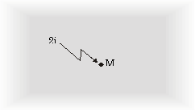
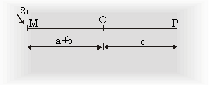
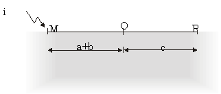
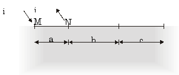

The Van Der Pauw theorem permits calculation of the sample's resistivity, regardless of the shape of the sample, provided electrical contacts are at (or near) the sample's periphery. The proof show here applies to contacts on the periphery of one half of an infinite plane, however it can be shown via conformal mapping that it is true for contacts on the periphery of an arbitrary finite shape as well. (Hall coefficient calculation does not rely on this theorem, but rather on the fact that all current traversing the sample from, say, contact A to contact C must pass between the other two contacts, across which the hall voltage is measured. – Can you see why?)

Proof of the Van Der Pauw Theorem

Let a sample be infinite in all directions. Then apply a current 2*i* to a point M (see figure A1).

**Figure A-1: infinite sample with a point M**

This current flows away from M with radial symmetry into infinity. Let d be the thickness of the sample and the resistivity. Then at a distance r from point M the current density is:

$J=\frac{2i}{2\pi rd}$ (A-1)

The electric field strength *E* is radially oriented and according to the generalized form of Ohm's law:

$\varepsilon=\rho J=\frac{\rho i}{\pi rd}$ (A-2)

The potential difference between any two point O and P lying on a straight line with M is (see figure A-2)

$V_P-V_O=\int_{P}^O E\cdot dr=\frac{\rho i}{\pi d}\int_{O}^P\frac{dr}{r}=-\frac{\rho i}{\pi d}ln(\frac{a+b+c}{a+b})$ (A-3)

**Figure A-2: Current applied to sample points on a line**

No current flows perpendicular to the line MOP. Therefore, the result is also valid if a part of the sample at one side of this line is omitted yielding a haft plane. Also halve the current from 2*i* to *i* (Figure A-3):

**Figure A-3: Semi-infinite sample with half the current applied**

Now consider a point N, where a current *i* flows out from it, which lies on the same line OP. Now we find the resistance (see figure A-4):

$R_{MN,OP}=\frac{\rho}{\pi d}ln\frac{(a+b)(b+c)}{(a+b+c)b}$ (A-4)

or

$\frac{(a+b+c)b}{(a+b)(b+c)}=exp(\frac{-\pi d}{\rho}R_{MN,OP})$ (A-5)

**Figure A-4: A sample with four points on a line**

Similarly we find:

$\frac{ac}{(a+b)(b+c)}= exp(\frac{-\pi d}{\rho}R_{NO,PM})$ (A-6)

Addition of the last two equations yields:

$exp(\frac{-pi d}{\rho}R{NO,PM})+exp(\frac{-\pi d}{\rho}R_{MN,OP})=1$ (A-7)

which is the same as equation *(13)*. To derive equation *(14)* which is:

$\rho=\frac{\pi d(R_{MN,OP}+R_{NO,PM})f}{ln2}$ (A-8)

equation (A-7) is used with:

$x_1=\pi dR_{MN,OP}$ (A-9a)

and

$x_2=\pi dR_{NO,PM}$ (A-9b)

which gives:

$exp(\frac{-x_1}{\rho})+exp(\frac{-x_2}{\rho})=1$ (A-10)

then write

$x_1=\frac{1}{2}((x_1+x_2)(x_1-x_2))$ (A-11a)

and

$x_2=\frac{1}{2}((x_1+x_2)-(x_1+x_2))$ (A-11b)

so equation (A-10) becomes:

$exp(\\frac{x\_1/x\_2}{2\\rho})\\cdot(exp(-\\frac{x\_1-x\_2}{2\\rho})+exp(\\frac{x\_1-x\_2}{2\\rho}))

\=1$ (A-12)

Using the hyperbolic cosine formula:

$cosh(x)=\frac{exp(x)-exp(-x)}{2}$ (A-13)

and rewriting equation (A-12) in terms of the hyperbolic cosine function:

$exp(-\frac{x_1-x_2}{2\rho})\cdot cosh(\frac{x_1-x_2}{2\rho})=\frac{1}{2}$ (A-14)

and now, defining ***f*** such that:

$(\frac{x_1+x_2}{2\rho})=\frac{ln2}{f}$ (A-15)

equation (A-14) becomes:

$exp(-\frac{ln2}{f})\cdot cosh(\frac{x_1/x_2-1}{x_1/x_2+1}\cdot \frac{ln2}{f})=\frac{1}{2}$ (A-16)

With a bit of patience, one can iteratively solve for ***f*** for any given ratio x1/x2. Finally, substituting for and from equations (A-9) gives:

$\rho=\frac{\pi d}{ln2}\cdot \frac{R_{MN,OP}+R_{NO,PM}}{2}f$ (A-17)

which is the same as equation *(14).* ***f*** is called the correction factor and is a function of the ratio of the two resistances RMN,OP and RNO,PM. (The graph of f versus the resistance ratio was given in Figure 5.)
